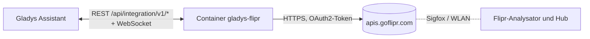
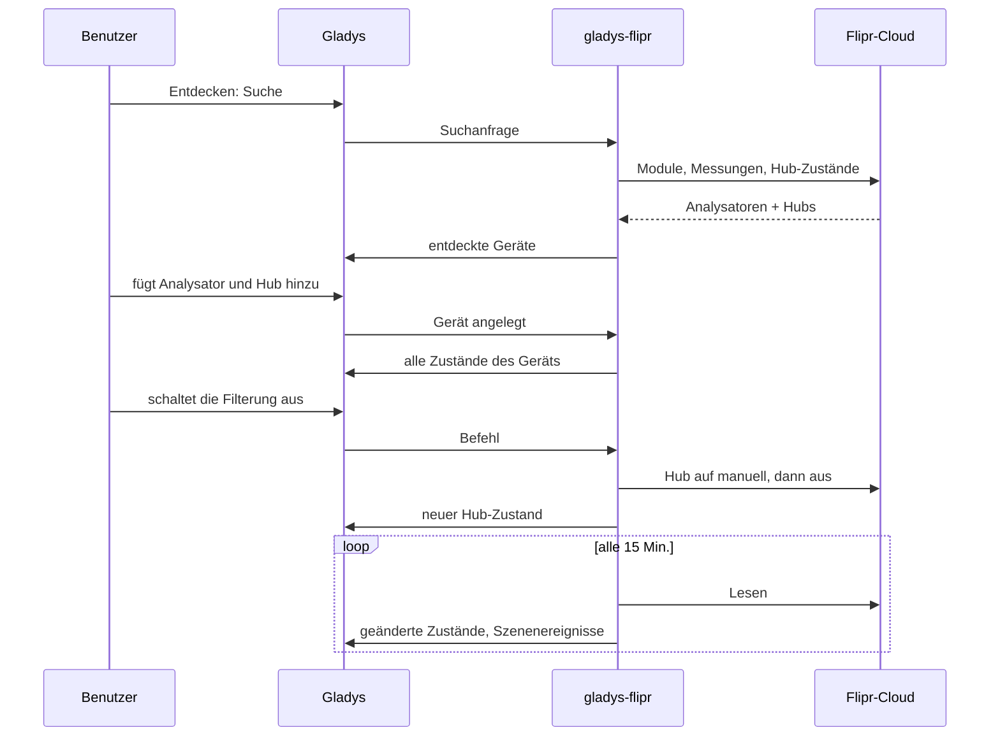
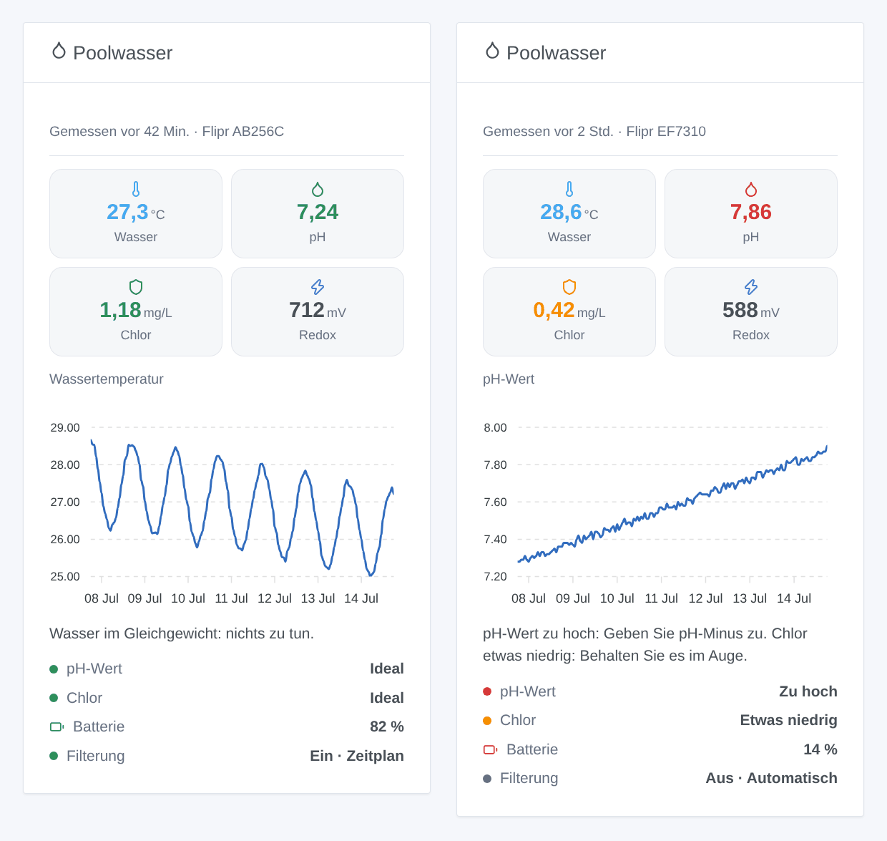

# Gladys Flipr

[English](README.md) · [Français](README.fr.md) · **Deutsch** · [Español](README.es.md)

[](LICENSE)
[](https://github.com/William-De71/gladys-flipr/releases)
[](https://github.com/William-De71/gladys-flipr/actions/workflows/release.yml)
[](https://gladysassistant.com)


Eine externe Integration für [Gladys Assistant](https://gladysassistant.com), die den vernetzten Poolanalysator Flipr und den Flipr Hub in Gladys bringt. Wassertemperatur, pH-Wert, Chlor und Redox werden zu Geräten, Szenenauslösern und einem Dashboard-Widget, und die Filterpumpe lässt sich aus Gladys steuern.

## Funktionen

- Ein **Gerät pro Flipr-Analysator**: Wassertemperatur, pH-Wert, Chlor, Redox (ORP), Batterie sowie die Bewertung von pH und Chlor durch Flipr (zu niedrig, etwas niedrig, ideal, etwas hoch, zu hoch).
- Ein **Gerät pro Flipr Hub**: Filterung ein/aus und Filtermodus (automatisch, manuell, Zeitplan), beides steuerbar.
- **4 Szenenauslöser**: neue Messung, Wasserbewertung geändert, seit 24 Stunden keine Messung, Filterung vom Hub umgeschaltet.
- **2 Szenenaktionen**: letzte Messung lesen, Filtermodus ändern.
- **1 Dashboard-Widget**: das Poolwasser auf einen Blick, mit dem Verlauf eines Werts und was zu tun ist.
- Englisch, Französisch, Deutsch und Spanisch überall.

## Funktionsweise




Flipr hat keine lokale API: Der Analysator sendet seine Messungen an die Flipr-Cloud (etwa einmal pro Stunde), und der Hub erhält dort seine Befehle. Die Integration meldet sich mit E-Mail und Passwort der Flipr-App an und liest das Konto dann standardmäßig alle 15 Minuten: die Liste der Module, die letzte Messung jedes Analysators und den Zustand jedes Hubs. Das erste Lesen nach einem Start dient als Referenz: Übergänge werden ab dem nächsten gemeldet.



### Transport

Nur **Cloud** (`"transports": ["cloud"]`): Gladys zeigt im Katalog das Cloud-Abzeichen. Die Integration spricht nur mit `apis.goflipr.com`. Ihre Flipr-E-Mail und Ihr Passwort verlassen Ihr Netz zur Flipr-Cloud, wie mit der Flipr-App; keine Daten gehen anderswohin.

## Geräte und Funktionen

| Gerät                      | Funktion         | Gladys-Kategorie / -Typ                  |
| -------------------------- | ---------------- | ---------------------------------------- |
| Flipr `<Seriennummer>`     | Wassertemperatur | Temperatursensor, °C                     |
|                            | pH-Wert          | pH-Sensor                                |
|                            | Chlor            | Füllstandssensor (dezimal), ppm (= mg/L) |
|                            | Redox (ORP)      | ORP-Sensor (Redox), mV                   |
|                            | Batterie         | Batterie, %                              |
|                            | pH-Zustand       | Text (Bewertung)                         |
|                            | Chlor-Zustand    | Text (Bewertung)                         |
| Flipr Hub `<Seriennummer>` | Filterung        | Schalter (ein/aus), steuerbar            |
|                            | Filtermodus      | Auswahl: automatisch, manuell, Zeitplan  |

Gladys hat keine Chlor-Kategorie: Chlor ist ein einfacher Dezimalsensor, der mit seinem Namen angezeigt wird. Die externen IDs beruhen auf den Seriennummern der Module. Das Ein- oder Ausschalten der Filterung versetzt den Hub in den manuellen Modus, wie die Flipr-App.

## Szenenauslöser, Aktionen und Widget

| Art      | Schlüssel              | Verwendung                                                                |
| -------- | ---------------------- | ------------------------------------------------------------------------- |
| Auslöser | `new_measure`          | Der Analysator hat eine neue Messung gesendet (alle Werte als Variablen)  |
| Auslöser | `water_status_changed` | Die Bewertung von pH oder Chlor hat sich geändert (Filter)                |
| Auslöser | `measures_stopped`     | Seit 24 Stunden keine Messung: Batterie, Wintermodus, Netz                |
| Auslöser | `filtration_changed`   | Der Hub hat die Pumpe selbst gestartet oder gestoppt (nicht bei Befehlen) |
| Aktion   | `get_measure`          | Die letzte Messung als Szenenausgaben                                     |
| Aktion   | `set_filtration_mode`  | Automatisch, manuell oder Zeitplan                                        |
| Widget   | `pool`                 | Kacheln, Verlaufsdiagramm, Hinweis, Bewertungen, Batterie, Filterung      |

Szenenbeispiele:

- Wenn die Wasserbewertung auf „Zu niedrig“ oder „Zu hoch“ wechselt → eine Nachricht mit `{{triggerEvent.data.summary}}` senden.
- Wenn es seit 24 Stunden keine Messung gibt → mich erinnern, die Batterie des Flipr zu prüfen.
- Jeden Abend um 20 Uhr → die letzte Messung lesen und „Wasser bei {{…temperature}} °C“ senden.
- Wenn der Strom günstig ist (Nebenzeit) → die Filterung einschalten (der Hub geht auf manuell); danach zurück auf Zeitplan.



## Voraussetzungen

- Gladys Assistant **5.1.0** oder neuer (Widgets und Szenen externer Integrationen). Ältere Instanzen können sie nicht installieren.
- Ein Flipr-Analysator (und optional ein Flipr Hub), der bereits in der Flipr-App funktioniert, mit E-Mail und Passwort.

## Installation

- **Aus dem Store**: Integrationen → „Flipr“ suchen → Installieren.
- **Über die Repository-URL**: Integrationen → Integration installieren → `https://github.com/William-De71/gladys-flipr`.
- **Entwicklermodus**: Integrationen → Integration installieren → Entwicklermodus, mit dem Image `ghcr.io/william-de71/gladys-flipr:<Version>`.

## Konfiguration

| Feld                 | Pflicht | Beschreibung                                                                           |
| -------------------- | ------- | -------------------------------------------------------------------------------------- |
| E-Mail               | Ja      | Die E-Mail Ihres Flipr-Kontos                                                          |
| Passwort             | Ja      | Als Geheimnis gespeichert, nie protokolliert                                           |
| Leseintervall (Min.) | Nein    | 5 bis 60, standardmäßig 15 (ein Analysator misst etwa einmal pro Stunde)               |
| Sprache der Texte    | Nein    | Namen der Funktionen, Bewertungen, Szenen-Zusammenfassungen; standardmäßig automatisch |

**Verbindung testen** meldet sich an und zählt die Analysatoren und Hubs des Kontos.

## Verwendung

1. E-Mail und Passwort der Flipr-App eingeben und speichern.
2. Geräte → Flipr → Entdecken: Analysator und Hub hinzufügen.
3. Szenen: einen Flipr-Auslöser wählen, nach einem Gerät filtern, die Variablen in einer Nachricht verwenden.
4. Dashboard: das Widget „Poolwasser“ hinzufügen, das Diagramm wählen.

Die Benutzerdokumentation steht in [docs/de.md](docs/de.md) ([en](docs/en.md), [fr](docs/fr.md), [es](docs/es.md)).

## Entwicklung

```bash
npm install
npm test                       # node --test, greift nie aufs Netz zu
npm run lint                   # ESLint
npm run format:check           # Prettier
npx github:GladysAssistant/integration-store . --skip-image-check
scripts/build-cover.sh         # cover.jpg aus docs/assets/cover.svg
docs/illustrations/render.sh   # docs/assets/widgets.<Sprache>.png
```

Lokal liest das SDK `GLADYS_HOST_API_URL`, `GLADYS_INTEGRATION_TOKEN` und `GLADYS_INTEGRATION_SELECTOR` (von Gladys im Entwicklermodus bereitgestellt). `DEBUG=gladys-integration-sdk` zeigt die Protokolle des SDK.

Die Tests decken den Flipr-Client, das Lesen der Antworten, die Übergänge, die Geräte (die Felder, die der Reiter Entdecken verlangt), das Widget (`validateWidgetContent`), die Szenenereignisse und -ausgaben, das Manifest, die vier Sprachen, das Release-Skript und die ganze Integration gegen das Fake-Gladys des SDK und eine Fake-Flipr-Cloud ab. `test/structure.test.js` friert alle bei den Nutzern gespeicherten Schlüssel ein.

## Release-Prozess


Jeder Merge auf `main` startet die CI und berechnet dann die Version aus den [Conventional Commits](https://www.conventionalcommits.org/) seit dem letzten Tag: `feat` → Minor, `fix` / `perf` → Patch, `!` oder `BREAKING CHANGE` → Major (ein Minor unter 1.0.0); `docs`, `chore`, `ci`, `test`, `style`, `refactor`, `build` allein veröffentlichen nichts. Der Changelog-Abschnitt wird erzeugt, der Tag gepusht, das Multi-Architektur-Image gebaut, dann erhält `main` den Release-Commit, das GitHub-Release wird erstellt und ein letzter Job prüft das öffentliche Image, den Store-Validator und das Topic.

- Der Titel des Pull-Requests wird zum Squash-Commit und dann zur Changelog-Zeile: Schreiben Sie ihn auf Englisch, für den Nutzer (`pr-title.yml` prüft ihn). Bearbeiten Sie `CHANGELOG.md` nie von Hand.
- 1.0.0 ist eine Entscheidung: Actions → Release → Run workflow mit `release-as: 1.0.0`. `dry-run` zeigt Version und Notizen, ohne etwas zu veröffentlichen.
- **Geschützter Branch**: Das Release pusht seinen Commit mit `GITHUB_TOKEN` auf `main`. Mit einem Ruleset auf `main` GitHub Actions zur Bypass-Liste hinzufügen (oder über eine GitHub App pushen), sonst schlägt der Veröffentlichungsjob mit Anweisungen fehl.
- Nach dem ersten Release das `ghcr.io`-Paket öffentlich machen (Package settings → Change visibility), sonst kann Gladys es nicht laden.

## Fehlerbehebung

Siehe [docs/de.md](docs/de.md#fehlerbehebung). Melden Sie Probleme mit den Versionen von Gladys und der Integration und den Protokollen (`DEBUG=gladys-integration-sdk`).

## Mitwirken

Issues und Pull-Requests sind willkommen. Führen Sie vor einem Pull-Request `npm run format:check && npm run lint && npm test` aus und lassen Sie alle externen IDs und gespeicherten Schlüssel unverändert (siehe [CLAUDE.md](CLAUDE.md)).

## Sicherheit

Siehe [SECURITY.md](SECURITY.md): Melden Sie Schwachstellen vertraulich. Das Passwort ist ein `secret`-Feld und wird nie protokolliert.

## Kommende Screenshots

Die Bilder oben sind Illustrationen, keine Screenshots. Echte Screenshots kommen in `docs/assets/screenshots/` (PNG, 1280 × 800): `configuration.png`, `discovery.png`, `devices.png`, `scene.png`.

## Lizenz

[Apache-Lizenz 2.0](LICENSE) — siehe auch [NOTICE](NOTICE). Flipr ist eine Marke ihres Inhabers; diese Community-Integration ist nicht mit Flipr verbunden. Sie stützt sich auf die API der Flipr-App, wie sie die Bibliothek [flipr-api](https://github.com/cnico/flipr-api) dokumentiert. Danke an die Dokumentation und das SDK von Gladys.
