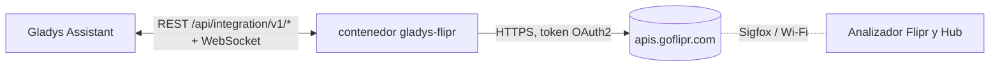
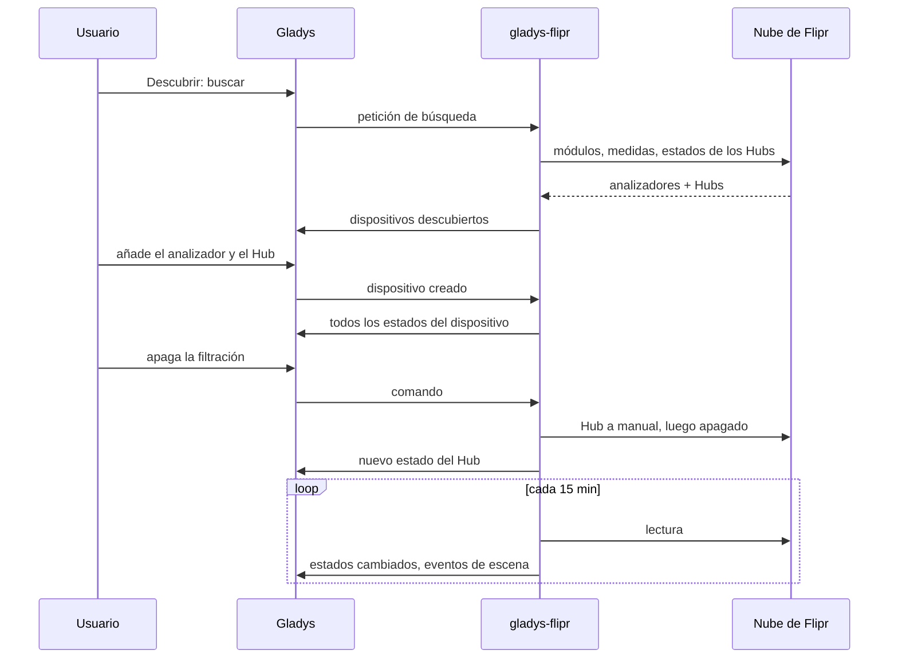
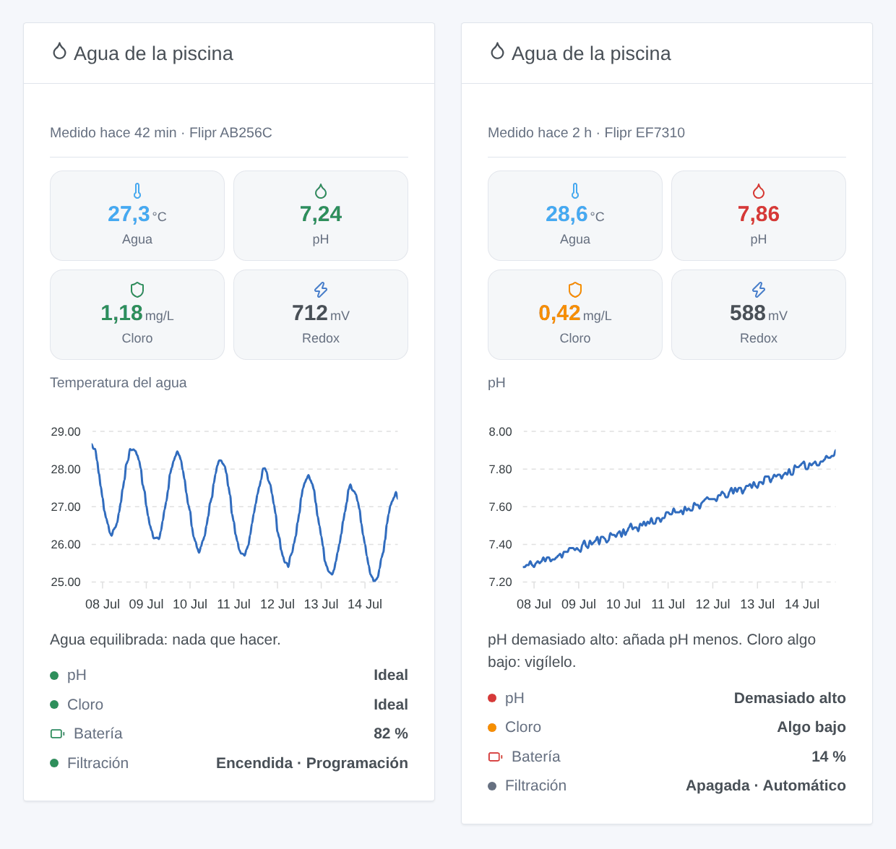

# Gladys Flipr

[English](README.md) · [Français](README.fr.md) · [Deutsch](README.de.md) · **Español**

[](LICENSE)
[](https://github.com/William-De71/gladys-flipr/releases)
[](https://github.com/William-De71/gladys-flipr/actions/workflows/release.yml)
[](https://gladysassistant.com)


Una integración externa para [Gladys Assistant](https://gladysassistant.com) que trae a Gladys el analizador de piscina conectado Flipr y el Flipr Hub. La temperatura del agua, el pH, el cloro y el redox se convierten en dispositivos, disparadores de escena y un widget de panel, y la bomba de filtración se controla desde Gladys.

## Funcionalidades

- Un **dispositivo por analizador Flipr**: temperatura del agua, pH, cloro, redox (ORP), batería, y la valoración del pH y del cloro que da Flipr (demasiado bajo, algo bajo, ideal, algo alto, demasiado alto).
- Un **dispositivo por Flipr Hub**: filtración encendida o apagada y modo de filtración (automático, manual, programación), ambos controlables.
- **4 disparadores de escena**: nueva medida, valoración del agua cambiada, sin medida desde hace 24 horas, filtración conmutada por el Hub.
- **2 acciones de escena**: leer la última medida, cambiar el modo de filtración.
- **1 widget de panel**: el agua de la piscina de un vistazo, con el historial de un valor y qué hacer.
- Inglés, francés, alemán y español en todas partes.

## Funcionamiento




Flipr no tiene API local: el analizador envía sus medidas a la nube de Flipr (aproximadamente una vez por hora), y el Hub recibe allí sus órdenes. La integración inicia sesión con el correo y la contraseña de la aplicación Flipr y luego lee la cuenta cada 15 minutos por defecto: la lista de módulos, la última medida de cada analizador y el estado de cada Hub. La primera lectura tras un arranque sirve de referencia: las transiciones se notifican a partir de la siguiente.



### Transporte

Solo **nube** (`"transports": ["cloud"]`): Gladys muestra el distintivo Nube en el catálogo. La integración solo habla con `apis.goflipr.com`. Su correo y su contraseña de Flipr salen de su red hacia la nube de Flipr, como con la aplicación Flipr; ningún dato va a otro sitio.

## Dispositivos y funciones

| Dispositivo                   | Función              | Categoría / tipo de Gladys                   |
| ----------------------------- | -------------------- | -------------------------------------------- |
| Flipr `<número de serie>`     | Temperatura del agua | Sensor de temperatura, °C                    |
|                               | pH                   | Sensor de pH                                 |
|                               | Cloro                | Sensor de nivel (decimal), ppm (= mg/L)      |
|                               | Redox (ORP)          | Sensor ORP (Redox), mV                       |
|                               | Batería              | Batería, %                                   |
|                               | Estado del pH        | Texto (valoración)                           |
|                               | Estado del cloro     | Texto (valoración)                           |
| Flipr Hub `<número de serie>` | Filtración           | Interruptor (encendido/apagado), controlable |
|                               | Modo de filtración   | Selección: automático, manual, programación  |

Gladys no tiene categoría para el cloro: es un simple sensor decimal, mostrado con su nombre. Los identificadores externos se basan en los números de serie de los módulos. Encender o apagar la filtración pone el Hub en modo manual, como hace la aplicación Flipr.

## Disparadores, acciones de escena y widget

| Tipo       | Clave                  | Uso                                                                        |
| ---------- | ---------------------- | -------------------------------------------------------------------------- |
| Disparador | `new_measure`          | El analizador envió una nueva medida (todos los valores como variables)    |
| Disparador | `water_status_changed` | El pH o el cloro cambió de valoración (filtros)                            |
| Disparador | `measures_stopped`     | Sin medida desde hace 24 horas: pila, modo invierno, red                   |
| Disparador | `filtration_changed`   | El Hub arrancó o paró la bomba por sí mismo (no con los comandos)          |
| Acción     | `get_measure`          | La última medida como salidas de escena                                    |
| Acción     | `set_filtration_mode`  | Automático, manual o programación                                          |
| Widget     | `pool`                 | Mosaicos, gráfico de historial, consejo, valoraciones, batería, filtración |

Ejemplos de escenas:

- Cuando la valoración del agua pase a «Demasiado bajo» o «Demasiado alto» → enviar un mensaje con `{{triggerEvent.data.summary}}`.
- Cuando no haya medida desde hace 24 horas → recordarme revisar la pila del Flipr.
- Cada tarde a las 20:00 → leer la última medida y enviar «agua a {{…temperature}} °C».
- Cuando la electricidad sea barata (horas valle) → encender la filtración (el Hub pasa a manual); después volver a programación.



## Requisitos

- Gladys Assistant **5.3.0** o posterior (palabras clave y países del catálogo de Gladys 5.3, widgets y escenas de las integraciones externas). Las instancias más antiguas no pueden instalarla.
- Un analizador Flipr (y opcionalmente un Flipr Hub) que ya funcione en la aplicación Flipr, con su correo y su contraseña.

## Instalación

- **Desde la tienda**: Integraciones → buscar «Flipr» → Instalar.
- **Desde la URL del repositorio**: Integraciones → Instalar una integración → `https://github.com/William-De71/gladys-flipr`.
- **Modo desarrollador**: Integraciones → Instalar una integración → Modo desarrollador, con la imagen `ghcr.io/william-de71/gladys-flipr:<versión>`.

## Configuración

| Campo                      | Obligatorio | Descripción                                                                              |
| -------------------------- | ----------- | ---------------------------------------------------------------------------------------- |
| Correo electrónico         | Sí          | El correo de su cuenta Flipr                                                             |
| Contraseña                 | Sí          | Guardada como secreto, nunca registrada                                                  |
| Intervalo de lectura (min) | No          | De 5 a 60, 15 por defecto (un analizador mide aproximadamente una vez por hora)          |
| Idioma de los textos       | No          | Nombres de las funciones, valoraciones, resúmenes de las escenas; automático por defecto |

**Probar la conexión** inicia sesión y cuenta los analizadores y Hubs de la cuenta.

## Uso

1. Introduzca el correo y la contraseña de la aplicación Flipr y guarde.
2. Dispositivos → Flipr → Descubrir: añada el analizador y el Hub.
3. Escenas: elija un disparador Flipr, filtre por un dispositivo, use las variables en un mensaje.
4. Panel: añada el widget «Agua de la piscina» y elija el gráfico.

La documentación de usuario está en [docs/es.md](docs/es.md) ([en](docs/en.md), [fr](docs/fr.md), [de](docs/de.md)).

## Desarrollo

```bash
npm install
npm test                       # node --test, nunca toca la red
npm run lint                   # ESLint
npm run format:check           # Prettier
npx github:GladysAssistant/integration-store . --skip-image-check
scripts/build-cover.sh         # cover.jpg a partir de docs/assets/cover.svg
docs/illustrations/render.sh   # docs/assets/widgets.<idioma>.png
```

En local, el SDK lee `GLADYS_HOST_API_URL`, `GLADYS_INTEGRATION_TOKEN` y `GLADYS_INTEGRATION_SELECTOR` (proporcionados por Gladys en modo desarrollador). `DEBUG=gladys-integration-sdk` muestra los registros del SDK.

Las pruebas cubren el cliente Flipr, la lectura de las respuestas, las transiciones, los dispositivos (los campos que exige la pestaña Descubrir), el widget (`validateWidgetContent`), los eventos y salidas de escena, el manifiesto, los cuatro idiomas, el script de publicación y toda la integración frente al Gladys falso del SDK y una nube Flipr falsa. `test/structure.test.js` congela todas las claves guardadas por los usuarios.

## Proceso de publicación


Cada fusión en `main` lanza la CI y luego calcula la versión a partir de los [Conventional Commits](https://www.conventionalcommits.org/) desde la última etiqueta: `feat` → menor, `fix` / `perf` → parche, `!` o `BREAKING CHANGE` → mayor (una menor por debajo de 1.0.0); `docs`, `chore`, `ci`, `test`, `style`, `refactor`, `build` solos no publican nada. Se genera la sección del changelog, se envía la etiqueta, se construye la imagen multiarquitectura, luego `main` recibe el commit de publicación, se crea la GitHub Release y un último job comprueba la imagen pública, el validador de la tienda y el topic.

- El título de la pull request se convierte en el commit squash y luego en la línea del changelog: escríbalo en inglés, para el usuario (`pr-title.yml` lo comprueba). No edite nunca `CHANGELOG.md` a mano.
- 1.0.0 es una decisión: Actions → Release → Run workflow con `release-as: 1.0.0`. `dry-run` muestra la versión y las notas sin publicar nada.
- **Rama protegida**: la publicación envía su commit a `main` con `GITHUB_TOKEN`. Con un ruleset en `main`, añada GitHub Actions a su lista de omisión (o envíe mediante una GitHub App); si no, el job de publicación falla con instrucciones.
- Tras la primera publicación, haga público el paquete `ghcr.io` (Package settings → Change visibility); si no, Gladys no puede descargarlo.

## Solución de problemas

Consulte [docs/es.md](docs/es.md#solución-de-problemas). Informe de los problemas con las versiones de Gladys y de la integración y los registros (`DEBUG=gladys-integration-sdk`).

## Contribuir

Las issues y pull requests son bienvenidas. Ejecute `npm run format:check && npm run lint && npm test` antes de abrir una pull request, y mantenga sin cambios todos los identificadores externos y claves guardadas (consulte [CLAUDE.md](CLAUDE.md)).

## Seguridad

Consulte [SECURITY.md](SECURITY.md): informe de las vulnerabilidades en privado. La contraseña es un campo `secret`, nunca registrado.

## Capturas por venir

Las imágenes anteriores son ilustraciones, no capturas de pantalla. Las capturas reales irán en `docs/assets/screenshots/` (PNG, 1280 × 800): `configuration.png`, `discovery.png`, `devices.png`, `scene.png`.

## Licencia

[Licencia Apache 2.0](LICENSE) — consulte también [NOTICE](NOTICE). Flipr es una marca de su propietario; esta integración comunitaria no está afiliada a Flipr. Se basa en la API de la aplicación Flipr, tal como la documenta la biblioteca [flipr-api](https://github.com/cnico/flipr-api). Gracias a la documentación y al SDK de Gladys.
