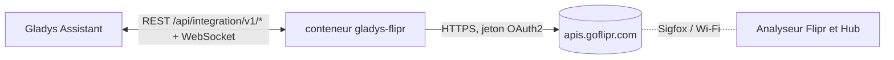
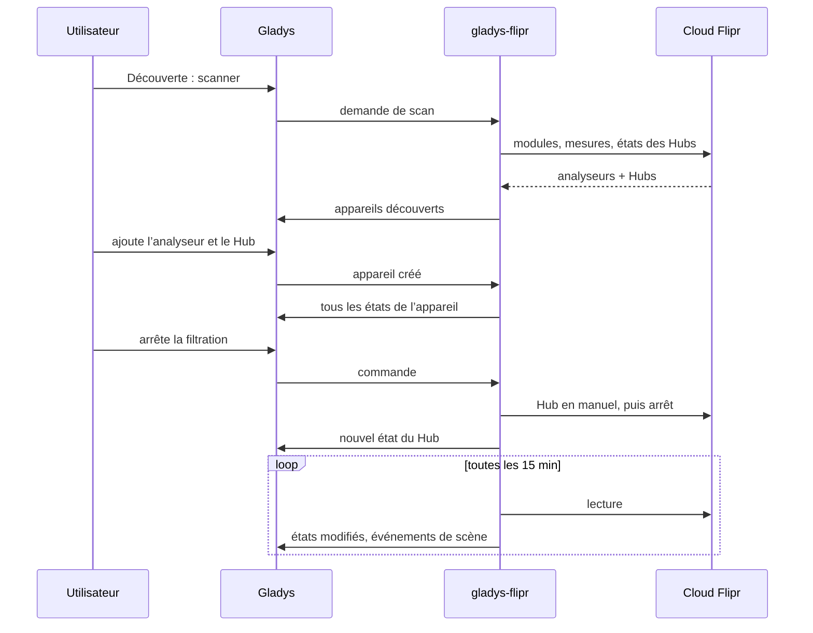
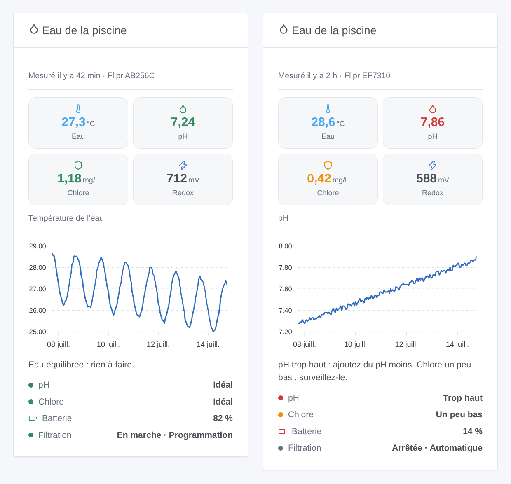

# Gladys Flipr

[English](README.md) · **Français** · [Deutsch](README.de.md) · [Español](README.es.md)

[](LICENSE)
[](https://github.com/William-De71/gladys-flipr/releases)
[](https://github.com/William-De71/gladys-flipr/actions/workflows/release.yml)
[](https://gladysassistant.com)


Une intégration externe pour [Gladys Assistant](https://gladysassistant.com) qui amène dans Gladys l’analyseur de piscine connecté Flipr et le Flipr Hub. Température de l’eau, pH, chlore et redox deviennent des appareils, des déclencheurs de scène et un widget de tableau de bord, et la pompe de filtration se pilote depuis Gladys.

## Fonctionnalités

- Un **appareil par analyseur Flipr** : température de l’eau, pH, chlore, redox (ORP), batterie, et l’évaluation du pH et du chlore donnée par Flipr (trop bas, un peu bas, idéal, un peu haut, trop haut).
- Un **appareil par Flipr Hub** : filtration en marche ou arrêtée et mode de filtration (automatique, manuel, programmation), tous deux pilotables.
- **4 déclencheurs de scène** : nouvelle mesure, évaluation de l’eau changée, aucune mesure depuis 24 heures, filtration basculée par le Hub.
- **2 actions de scène** : lire la dernière mesure, changer le mode de filtration.
- **1 widget de tableau de bord** : l’eau de la piscine en un coup d’œil, avec l’historique d’une valeur et quoi faire.
- Anglais, français, allemand et espagnol partout.

## Fonctionnement




Flipr n’a pas d’API locale : l’analyseur envoie ses mesures au cloud Flipr (environ une fois par heure), et le Hub y reçoit ses ordres. L’intégration se connecte avec l’e-mail et le mot de passe de l’application Flipr, puis lit le compte toutes les 15 minutes par défaut : la liste des modules, la dernière mesure de chaque analyseur et l’état de chaque Hub. La première lecture après un démarrage sert de référence : les transitions sont signalées à partir de la suivante.



### Transport

**Cloud** uniquement (`"transports": ["cloud"]`) : Gladys affiche le badge Cloud dans le catalogue. L’intégration ne parle qu’à `apis.goflipr.com`. Votre e-mail et votre mot de passe Flipr quittent votre réseau vers le cloud Flipr, comme avec l’application Flipr ; aucune donnée ne part ailleurs.

## Appareils et fonctionnalités

| Appareil            | Fonctionnalité       | Catégorie / type Gladys                        |
| ------------------- | -------------------- | ---------------------------------------------- |
| Flipr `<série>`     | Température de l’eau | Capteur de température, °C                     |
|                     | pH                   | Capteur de pH                                  |
|                     | Chlore               | Capteur de niveau (décimal), ppm (= mg/L)      |
|                     | Redox (ORP)          | Capteur Redox / ORP, mV                        |
|                     | Batterie             | Batterie, %                                    |
|                     | État du pH           | Texte (évaluation)                             |
|                     | État du chlore       | Texte (évaluation)                             |
| Flipr Hub `<série>` | Filtration           | Interrupteur (marche/arrêt), pilotable         |
|                     | Mode de filtration   | Sélection : automatique, manuel, programmation |

Gladys n’a pas de catégorie pour le chlore : c’est un simple capteur décimal, affiché avec son nom. Les identifiants externes reposent sur les numéros de série des modules. Démarrer ou arrêter la filtration met le Hub en mode manuel, comme le fait l’application Flipr.

## Déclencheurs, actions de scène et widget

| Type        | Clé                    | Usage                                                                      |
| ----------- | ---------------------- | -------------------------------------------------------------------------- |
| Déclencheur | `new_measure`          | L’analyseur a envoyé une nouvelle mesure (toutes les valeurs en variables) |
| Déclencheur | `water_status_changed` | Le pH ou le chlore a changé d’évaluation (filtres)                         |
| Déclencheur | `measures_stopped`     | Aucune mesure depuis 24 heures : pile, mode hiver, réseau                  |
| Déclencheur | `filtration_changed`   | Le Hub a démarré ou arrêté la pompe de lui-même (pas pour les commandes)   |
| Action      | `get_measure`          | La dernière mesure en sorties de scène                                     |
| Action      | `set_filtration_mode`  | Automatique, manuel ou programmation                                       |
| Widget      | `pool`                 | Tuiles, graphique d’historique, conseil, évaluations, batterie, filtration |

Exemples de scènes :

- Quand l’évaluation de l’eau passe à « Trop bas » ou « Trop haut » → envoyer un message avec `{{triggerEvent.data.summary}}`.
- Quand il n’y a aucune mesure depuis 24 heures → me rappeler de vérifier la pile du Flipr.
- Chaque soir à 20 h → lire la dernière mesure et envoyer « eau à {{…temperature}} °C ».
- Quand l’électricité est bon marché (heures creuses) → démarrer la filtration (le Hub passe en manuel) ; repasser en programmation ensuite.



## Prérequis

- Gladys Assistant **5.3.0** ou plus récent (mots-clés et pays du catalogue de Gladys 5.3, widgets et scènes des intégrations externes). Les instances plus anciennes ne peuvent pas l’installer.
- Un analyseur Flipr (et éventuellement un Flipr Hub) qui fonctionne déjà dans l’application Flipr, avec son e-mail et son mot de passe.

## Installation

- **Depuis le store** : Intégrations → chercher « Flipr » → Installer.
- **Depuis l’URL du dépôt** : Intégrations → Installer une intégration → `https://github.com/William-De71/gladys-flipr`.
- **Mode développeur** : Intégrations → Installer une intégration → Mode développeur, avec l’image `ghcr.io/william-de71/gladys-flipr:<version>`.

## Configuration

| Champ                       | Obligatoire | Description                                                                        |
| --------------------------- | ----------- | ---------------------------------------------------------------------------------- |
| E-mail                      | Oui         | L’e-mail de votre compte Flipr                                                     |
| Mot de passe                | Oui         | Enregistré comme secret, jamais journalisé                                         |
| Intervalle de lecture (min) | Non         | De 5 à 60, 15 par défaut (un analyseur mesure environ une fois par heure)          |
| Langue des textes           | Non         | Noms des fonctionnalités, évaluations, résumés des scènes ; automatique par défaut |

**Tester la connexion** se connecte et compte les analyseurs et Hubs du compte.

## Utilisation

1. Saisissez l’e-mail et le mot de passe de l’application Flipr, puis enregistrez.
2. Appareils → Flipr → Découverte : ajoutez l’analyseur et le Hub.
3. Scènes : choisissez un déclencheur Flipr, filtrez sur un appareil, utilisez les variables dans un message.
4. Tableau de bord : ajoutez le widget « Eau de la piscine », choisissez le graphique.

La documentation utilisateur est dans [docs/fr.md](docs/fr.md) ([en](docs/en.md), [de](docs/de.md), [es](docs/es.md)).

## Développement

```bash
npm install
npm test                       # node --test, ne touche jamais le réseau
npm run lint                   # ESLint
npm run format:check           # Prettier
npx github:GladysAssistant/integration-store . --skip-image-check
scripts/build-cover.sh         # cover.jpg depuis docs/assets/cover.svg
docs/illustrations/render.sh   # docs/assets/widgets.<langue>.png
```

En local, le SDK lit `GLADYS_HOST_API_URL`, `GLADYS_INTEGRATION_TOKEN` et `GLADYS_INTEGRATION_SELECTOR` (fournis par Gladys en mode développeur). `DEBUG=gladys-integration-sdk` affiche les journaux du SDK.

Les tests couvrent le client Flipr, la lecture des réponses, les transitions, les appareils (les champs qu’exige l’écran de découverte), le widget (`validateWidgetContent`), les événements et sorties de scène, le manifeste, les quatre langues, le script de release, et toute l’intégration face au faux Gladys du SDK et à un faux cloud Flipr. `test/structure.test.js` fige toutes les clés stockées chez les utilisateurs.

## Processus de release


Chaque fusion sur `main` lance la CI, puis calcule la version à partir des [Conventional Commits](https://www.conventionalcommits.org/) depuis le dernier tag : `feat` → mineure, `fix` / `perf` → correctif, `!` ou `BREAKING CHANGE` → majeure (une mineure tant qu’on est sous 1.0.0) ; `docs`, `chore`, `ci`, `test`, `style`, `refactor`, `build` seuls ne publient rien. La section du changelog est générée, le tag poussé, l’image multi-architecture construite, puis `main` reçoit le commit de release, la GitHub Release est créée et un dernier job vérifie l’image publique, le validateur du store et le topic.

- Le titre de la pull request devient le commit squash, puis la ligne du changelog : écrivez-le en anglais, pour l’utilisateur (`pr-title.yml` le vérifie). Ne modifiez jamais `CHANGELOG.md` à la main.
- 1.0.0 est une décision : Actions → Release → Run workflow avec `release-as: 1.0.0`. `dry-run` affiche la version et les notes sans rien publier.
- **Branche protégée** : la release pousse son commit sur `main` avec `GITHUB_TOKEN`. Avec un ruleset sur `main`, ajoutez GitHub Actions à sa liste de contournement (ou poussez via une GitHub App), sinon le job de publication échoue avec des instructions.
- Après la première release, rendez public le package `ghcr.io` (Package settings → Change visibility), sinon Gladys ne peut pas le télécharger.

## Dépannage

Voir [docs/fr.md](docs/fr.md#dépannage). Signalez les problèmes avec les versions de Gladys et de l’intégration et les journaux (`DEBUG=gladys-integration-sdk`).

## Contribuer

Issues et pull requests sont les bienvenues. Lancez `npm run format:check && npm run lint && npm test` avant d’ouvrir une pull request, et gardez inchangés tous les identifiants externes et toutes les clés stockées (voir [CLAUDE.md](CLAUDE.md)).

## Sécurité

Voir [SECURITY.md](SECURITY.md) : signalez les vulnérabilités en privé. Le mot de passe est un champ `secret`, jamais journalisé.

## Captures à venir

Les images ci-dessus sont des illustrations, pas des captures d’écran. Les vraies captures iront dans `docs/assets/screenshots/` (PNG, 1280 × 800) : `configuration.png`, `discovery.png`, `devices.png`, `scene.png`.

## Licence

[Licence Apache 2.0](LICENSE) — voir aussi [NOTICE](NOTICE). Flipr est une marque de son propriétaire ; cette intégration communautaire n’est pas affiliée à Flipr. Elle s’appuie sur l’API de l’application Flipr, telle que documentée par la bibliothèque [flipr-api](https://github.com/cnico/flipr-api). Merci à la documentation et au SDK de Gladys.
