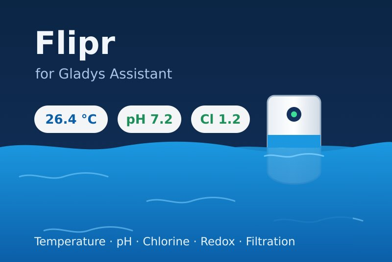
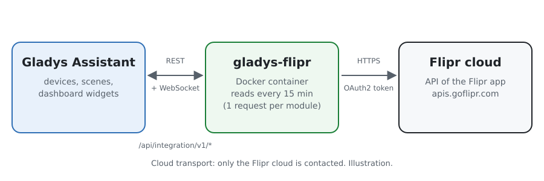
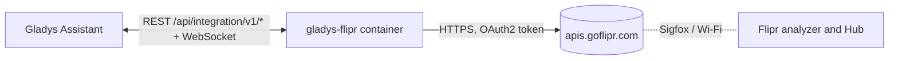
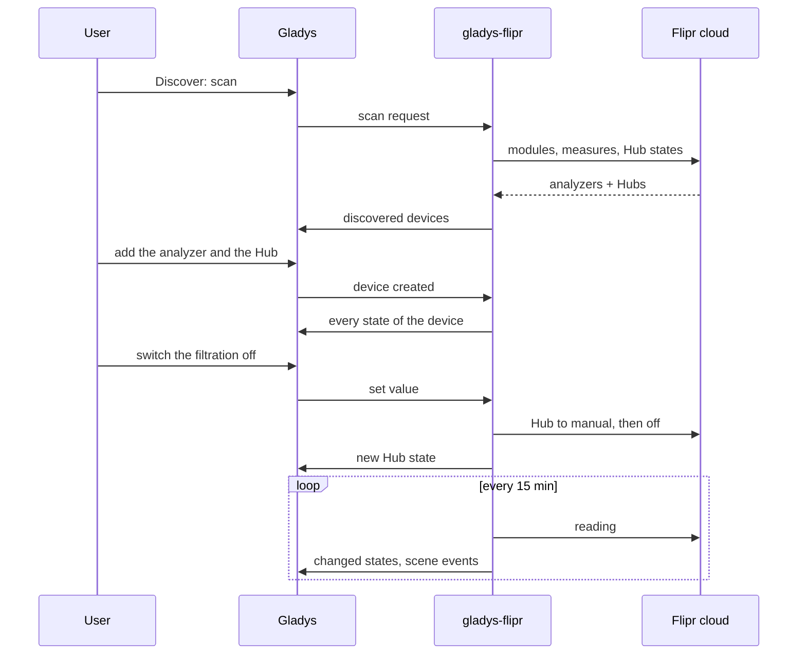
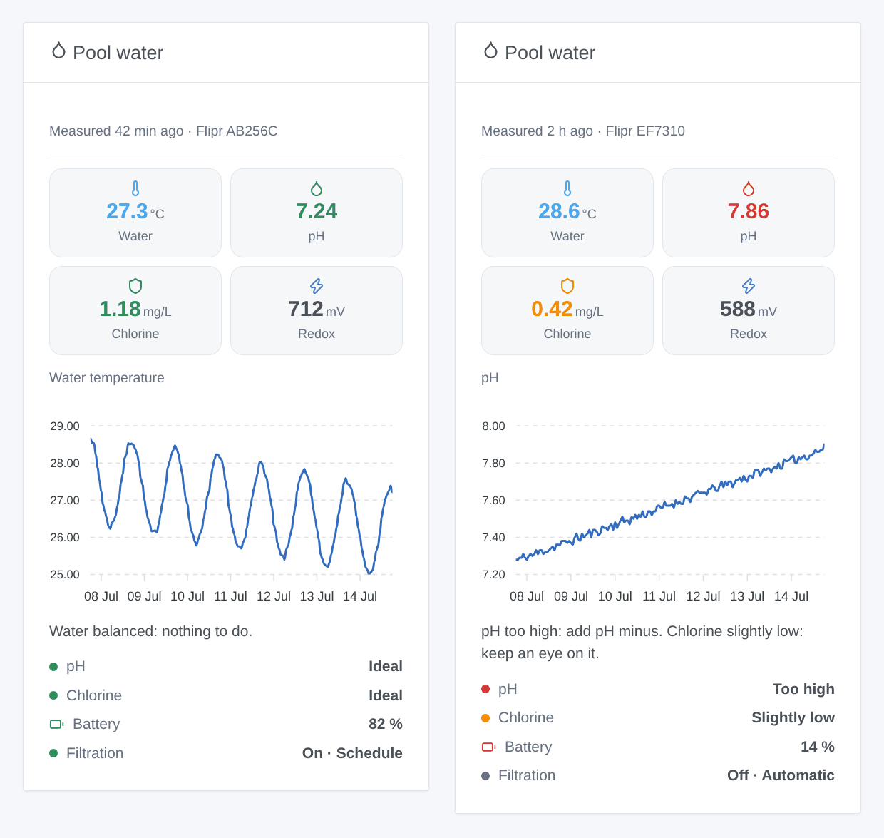

# Gladys Flipr

**English** · [Français](README.fr.md) · [Deutsch](README.de.md) · [Español](README.es.md)

[](LICENSE)
[](https://github.com/William-De71/gladys-flipr/releases)
[](https://github.com/William-De71/gladys-flipr/actions/workflows/release.yml)
[](https://gladysassistant.com)



An external integration for [Gladys Assistant](https://gladysassistant.com) that brings the Flipr connected pool analyzer and the Flipr Hub into Gladys. Water temperature, pH, chlorine and redox become devices, scene triggers and a dashboard widget, and the filtration pump can be driven from Gladys.

## Features

- A **device per Flipr analyzer**: water temperature, pH, chlorine, redox (ORP), battery, and the pH and chlorine ratings Flipr gives (too low, slightly low, ideal, slightly high, too high).
- A **device per Flipr Hub**: filtration on/off and filtration mode (automatic, manual, schedule), both controllable.
- **4 scene triggers**: new measure, water rating changed, no measure for 24 hours, filtration switched by the Hub.
- **2 scene actions**: read the latest measure, change the filtration mode.
- **1 dashboard widget**: the pool water at a glance, with the history of one value and what to do.
- English, French, German and Spanish everywhere.

## How it works





Flipr has no local API: the analyzer sends its measures to the Flipr cloud (about once an hour), and the Hub takes its orders from it. The integration signs in with the e-mail and the password of the Flipr app, then reads the account every 15 minutes by default: the list of modules, the latest measure of each analyzer and the state of each Hub. The first reading after a start is a reference: transitions are reported from the next one on.



### Transport

**Cloud** only (`"transports": ["cloud"]`): Gladys shows the Cloud badge in the catalog. The integration talks to `apis.goflipr.com` and nothing else. Your Flipr e-mail and password leave your network for the Flipr cloud, as they do with the Flipr app; no data goes anywhere else.

## Devices and features

| Device               | Feature           | Gladys category / type               |
| -------------------- | ----------------- | ------------------------------------ |
| Flipr `<serial>`     | Water temperature | Temperature sensor, °C               |
|                      | pH                | pH sensor                            |
|                      | Chlorine          | Level sensor (decimal), ppm (= mg/L) |
|                      | Redox (ORP)       | ORP sensor, mV                       |
|                      | Battery           | Battery, %                           |
|                      | pH status         | Text (rating)                        |
|                      | Chlorine status   | Text (rating)                        |
| Flipr Hub `<serial>` | Filtration        | Switch (on/off), controllable        |
|                      | Filtration mode   | Select: automatic, manual, schedule  |

Gladys has no chlorine category: the chlorine is a plain decimal sensor, shown with its name. External ids rely on the serial numbers of the modules. Switching the filtration on or off puts the Hub in manual mode, as the Flipr app does.

## Scene triggers, actions and widget

| Kind    | Key                    | Use                                                              |
| ------- | ---------------------- | ---------------------------------------------------------------- |
| Trigger | `new_measure`          | The analyzer sent a new measure (all values as variables)        |
| Trigger | `water_status_changed` | The pH or the chlorine moved to another rating (filters)         |
| Trigger | `measures_stopped`     | No measure for 24 hours: battery, winter mode, network           |
| Trigger | `filtration_changed`   | The Hub started or stopped the pump by itself (not for commands) |
| Action  | `get_measure`          | The latest measure as scene outputs                              |
| Action  | `set_filtration_mode`  | Automatic, manual or schedule                                    |
| Widget  | `pool`                 | Tiles, history chart, advice, ratings, battery, filtration       |

Scene examples:

- When the water rating changes to "Too low" or "Too high" → send a message with `{{triggerEvent.data.summary}}`.
- When there is no measure for 24 hours → remind me to check the Flipr battery.
- Every evening at 8 pm → read the latest measure and send "water at {{…temperature}} °C".
- When the electricity is cheap (off-peak hours) → put the filtration in manual and switch it on; back to schedule afterwards.



## Requirements

- Gladys Assistant **5.3.0** or later (catalog keywords and countries of Gladys 5.3, widgets and scenes of external integrations). Older instances cannot install it.
- A Flipr analyzer (and optionally a Flipr Hub) already working in the Flipr app, with its e-mail and password.

## Installation

- **From the store**: Integrations → search "Flipr" → Install.
- **From the repository URL**: Integrations → Install an integration → `https://github.com/William-De71/gladys-flipr`.
- **Developer mode**: Integrations → Install an integration → Developer mode, with the image `ghcr.io/william-de71/gladys-flipr:<version>`.

## Configuration

| Field                  | Required | Description                                                      |
| ---------------------- | -------- | ---------------------------------------------------------------- |
| E-mail                 | Yes      | The e-mail of your Flipr account                                 |
| Password               | Yes      | Stored as a secret, never logged                                 |
| Reading interval (min) | No       | 5 to 60, 15 by default (an analyzer measures about once an hour) |
| Language of the texts  | No       | Feature names, ratings, scene summaries; automatic by default    |

**Test the connection** signs in and counts the analyzers and Hubs of the account.

## Usage

1. Enter the e-mail and the password of the Flipr app, then save.
2. Devices → Flipr → Discover: add the analyzer and the Hub.
3. Scenes: pick a Flipr trigger, filter on a device, use the variables in a message.
4. Dashboard: add the "Pool water" widget, choose the chart.

The user documentation is in [docs/en.md](docs/en.md) ([fr](docs/fr.md), [de](docs/de.md), [es](docs/es.md)).

## Development

```bash
npm install
npm test                       # node --test, never touches the network
npm run lint                   # ESLint
npm run format:check           # Prettier
npx github:GladysAssistant/integration-store . --skip-image-check
scripts/build-cover.sh         # cover.jpg from docs/assets/cover.svg
docs/illustrations/render.sh   # docs/assets/widgets.<lang>.png
```

Locally, the SDK reads `GLADYS_HOST_API_URL`, `GLADYS_INTEGRATION_TOKEN` and `GLADYS_INTEGRATION_SELECTOR` (given by Gladys in developer mode). `DEBUG=gladys-integration-sdk` shows the SDK logs.

The tests cover the Flipr client, the reading of the answers, the transitions, the devices (the fields the Discovery screen requires), the widget (`validateWidgetContent`), the scene events and outputs, the manifest, the four languages, the release script, and the whole integration against the fake Gladys of the SDK and a fake Flipr cloud. `test/structure.test.js` freezes every key users store.

## Release process


Every merge on `main` runs the CI, then computes the version from the [Conventional Commits](https://www.conventionalcommits.org/) since the last tag: `feat` → minor, `fix` / `perf` → patch, `!` or `BREAKING CHANGE` → major (a minor below 1.0.0); `docs`, `chore`, `ci`, `test`, `style`, `refactor`, `build` alone publish nothing. The changelog section is generated, the tag pushed, the multi-architecture image built, then `main` receives the release commit, the GitHub Release is created and a last job checks the public image, the store validator and the topic.

- The pull request title becomes the squash commit, then the changelog line: write it in English, for the user (`pr-title.yml` checks it). Never edit `CHANGELOG.md` by hand.
- 1.0.0 is a decision: Actions → Release → Run workflow with `release-as: 1.0.0`. `dry-run` shows the version and the notes without publishing.
- **Protected branch**: the release pushes its commit to `main` with `GITHUB_TOKEN`. With a ruleset on `main`, add GitHub Actions to its bypass list (or push through a GitHub App), otherwise the publish job fails with instructions.
- After the first release, make the `ghcr.io` package public (Package settings → Change visibility), or Gladys cannot pull it.

## Troubleshooting

See [docs/en.md](docs/en.md#troubleshooting). Report issues with the Gladys and integration versions and the logs (`DEBUG=gladys-integration-sdk`).

## Contributing

Issues and pull requests are welcome. Run `npm run format:check && npm run lint && npm test` before opening a pull request, and keep every external id and stored key unchanged (see [CLAUDE.md](CLAUDE.md)).

## Security

See [SECURITY.md](SECURITY.md): report vulnerabilities privately. The password is a `secret` field, never logged.

## Screenshots to come

The images above are illustrations, not screenshots. Real screenshots will go in `docs/assets/screenshots/` (PNG, 1280 × 800): `configuration.png`, `discovery.png`, `devices.png`, `scene.png`.

## License

[Apache License 2.0](LICENSE) — see also [NOTICE](NOTICE). Flipr is a trademark of its owner; this community integration is not affiliated with Flipr. It relies on the API of the Flipr app, as documented by the [flipr-api](https://github.com/cnico/flipr-api) library. Thanks to the Gladys documentation and SDK.
